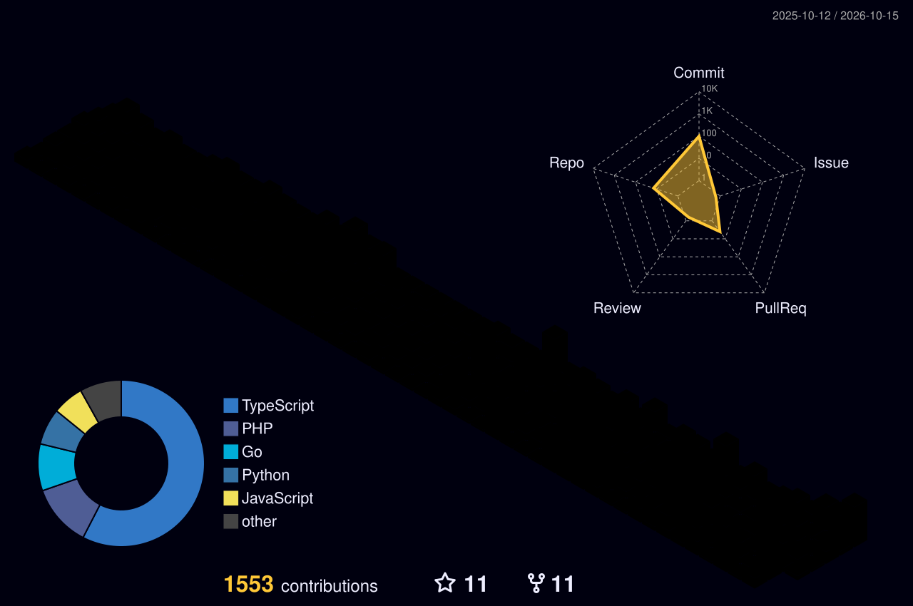

<!-- Typing SVG Terminal Headline with Portfolio Brand Palette -->

  
  

<!-- Quick Action Navigation -->

  
  
  
  

 

### // Philosophy

> *"Code is a tool; the primary objective is untangling operational bottlenecks and building resilient foundations."*

I partner with engineering teams and businesses to design scalable web architectures, optimize database throughput, and operate reliable cloud infrastructure. Over the past 3 years, my work has focused on high-availability systems, mission-critical ERP platforms, and cloud migrations with zero data loss.

---

### // Currently

* Architecting resilient cloud infrastructures for high-availability systems.
* Building high-throughput B2B SaaS platforms with Next.js, Bun, and Laravel.
* Integrating AI tooling into practical developer workflows and automation pipelines.

---

### // Commercial & Enterprise Highlights

#### Waskita Beton Precast
*Lead Architecture & Infrastructure Migration*

Architected and migrated the core system of a state-owned construction enterprise to a containerized Laravel and Docker infrastructure. Achieved zero data loss during cutover, eliminated legacy security vulnerabilities, and delivered substantial query execution gains for internal operational teams.

#### Harmony Kids School ERP
*Full Stack Engineer*

Engineered an integrated multi-branch school administration platform. Built an automated WhatsApp notification gateway, student savings accounting engine, and real-time financial reporting dashboard with strict multi-tenant data isolation.

#### Carivendor B2B Marketplace
*Cloud & Backend Engineer*

Deployed an auto-scaling B2B commerce platform on AWS using Docker containerization. Integrated PayPal payment flows and optimized mission-critical database indexes, cutting checkout latency by 35% during peak trading intervals.

#### TomatoSuki Stream Engine
*Systems & Backend Engineer*

Built an ultra-low latency media delivery API microservice using Bun and ElysiaJS. Delivered 3x faster response times compared to previous Node.js and Express implementations under equivalent concurrency.

  <b><a href="https://www.fadhilaabiyyu.my.id/projects">▶ View all case studies and architecture deep-dives</a></b>

---

### // Technical Arsenal

**Frontend Architecture**
 

  

**Backend & Systems**
 

  

**Cloud & DevOps**
 

  

**Databases & Storage**
 

---

### // 3D Contribution & Activity Analytics

**3D Isometric Contribution Calendar**
  
<picture>
  <source media="(prefers-color-scheme: dark)" srcset="profile-3d-contrib/profile-night-rainbow.svg">
  <source media="(prefers-color-scheme: light)" srcset="profile-3d-contrib/profile-green-animate.svg">
  
</picture>

  

**Contribution Stream**
  
<picture>
  <source media="(prefers-color-scheme: dark)" srcset="https://raw.githubusercontent.com/Fadhila36/Fadhila36/output/snake.svg">
  <source media="(prefers-color-scheme: light)" srcset="https://raw.githubusercontent.com/Fadhila36/Fadhila36/output/snake.svg">
  
</picture>

  

**Engineering Activity & Streak**
  

  

---

### // Coding Inspiration

  
    
  <i>"Great code is born from focus, discipline, and a touch of creativity."</i>

---

### // Contact & Collaboration

Available for Senior and Lead Software Engineering positions, contract architecture, and technical consulting.

 

